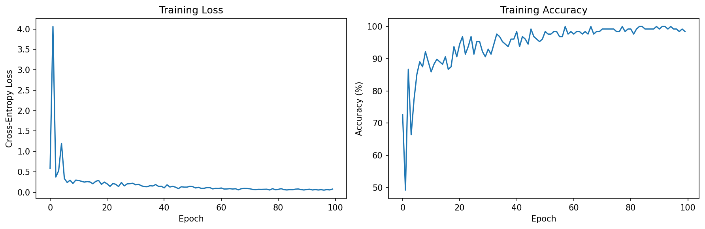
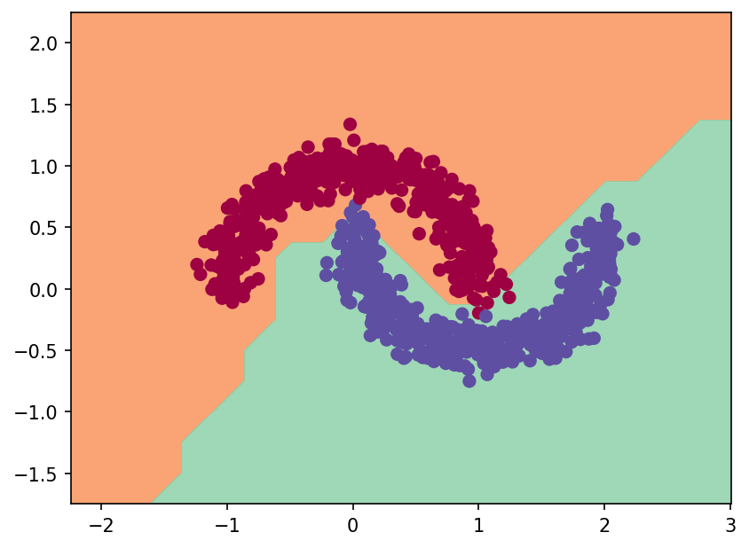
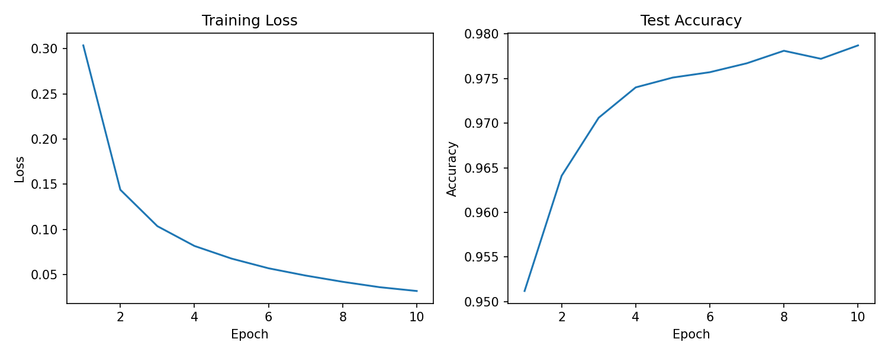
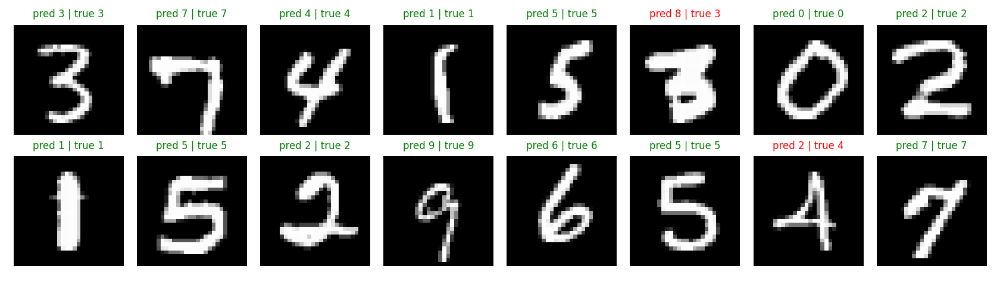

# Autograd from First Principles

This project is a deep dive into the mechanics of automatic differentiation. Inspired by Andrej Karpathy’s `micrograd`, this repository builds a backpropagation engine from the ground up.

We begin with a **scalar-based autograd engine**, where gradients are tracked on individual numbers to build intuition from first principles.

Once the core ideas are clear, we scale the design to **n-dimensional arrays (tensors)**, mimicking how autograd engines like PyTorch's operate internally.

## Project Structure

```
autograd/
│
├── scalar/                # Scalar-based reverse-mode autodiff
│   ├── engine.py          # Value class and backward propagation logic
│   ├── nn.py              # Neuron / MLP built using scalar engine
│   └── graphic.py         # Computational graph visualization
│
├── tensor/                # Tensor-based autograd engine
│   ├── engine.py          # Tensor class and gradient propagation
│   └── nn.py              # Neural network modules (tensor version)
│
notebooks/
│   ├── autograd_scalar_demo.ipynb
│   └── autograd_tensor_demo.ipynb
│
pyproject.toml             # Package configuration
README.md
```

## What is Autograd?

An **autograd** (_automatic gradient_) engine implements reverse-mode automatic differentiation — the algorithm underlying backpropagation — which efficiently evaluates the gradients of a loss function with respect to its parameters.

Neural networks are effectively a large composite functions:

$$
L = f(g(h(x)))
$$

During training, we need the gradient of the loss with respect to its **every parameter**:

$$
\frac{\partial L}{\partial \theta}
$$

Instead of analytically differentiating the entire expression, autograd works by:

1. **Recording operations** during the forward pass.
2. **Building a computational graph** that captures how each value depends on others.
3. **Storing gradients** for each parameters.
4. **Propagating gradients backward** using the chain rule:
   each node's gradient = its local derivative × the gradient flowing in from downstream.

This backward propagation of gradients from the output to the inputs is known as **backpropagation**.

It enables gradient-based optimization, such as:

$$
\theta = \theta - \alpha \frac{\partial L}{\partial \theta}
$$

**The scalar engine** implements the nodes on a Value (Scalar) level.
**The tensor engine** further extends it to n-dimensional arrays (Tensor) for efficiency.

---

## Demonstration

The purpose of the demonstration is to show that the optimizations can be performed using the custom autograd engine through experiments:

- **Scalar Engine** — Trained a simple MLP on the `make_moons` dataset.
- **Tensor Engine** — Trained an MLP on a subset of the `MNIST` dataset.

### Scalar Engine

- MLP Architecture: 2 → 32 → 16 → 2
- Activation: `ReLU`
- Optimizer: Stochastic Gradient Descent
- Learning Rate: 0.01
- Loss: Binary classification loss
- Dataset: `make_moons()`
- Final Training Accuracy:`~99.22%`

#### Training Loss Curve

<p align="center">
  
</p>

#### Decision Boundary

<p align="center">
  
</p>

### Tensor Engine — MNIST (Subset)

- MLP Architecture: 784 → 128 → 10
- Activation: ReLU
- Optimizer: Stochastic Gradient Descent
- Learning Rate: 0.1
- Loss: Cross-Entropy
- Dataset: Subset of MNIST
- Final Test Accuracy: `97.87%`

#### Training Loss Curve

<p align="center">
  
</p>

#### Sample Predictions

<p align="center">
  
</p>

## Installation

```bash
git clone https://github.com/Dhiranjit/autograd-from-first-principles.git
cd autograd-from-first-principles
pip install -e .
```
